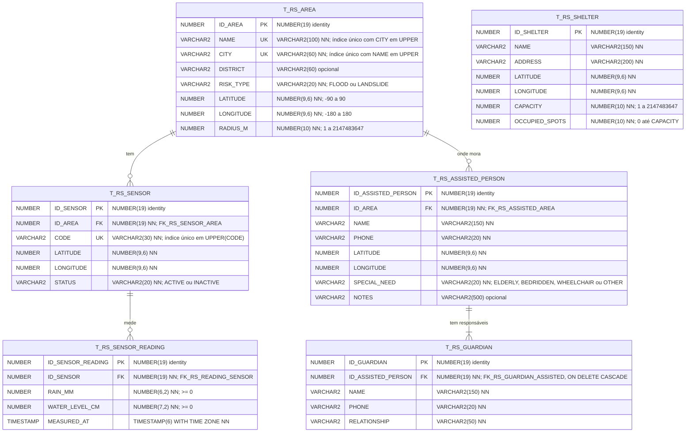

# Rota Segura — DER (modelo de dados)

Gerado a partir de `database-design/ddl.sql` (Oracle). Serve de referência para o modelo lógico do **Oracle Data Modeler** (exigido pela rubrica de Database Design) e para o PDF de DDD Java.

No diagrama, o tipo de cada coluna aparece entre aspas (o Mermaid não aceita vírgula no nome do tipo). Todos os textos são `VARCHAR2(n CHAR)` e todas as chaves primárias são `NUMBER(19) GENERATED ALWAYS AS IDENTITY`. `UK` marca as colunas cobertas por um **índice único** (sobre `UPPER(...)`, para não diferenciar maiúsculas); não são constraints `UNIQUE`, e é assim que aparecem no Data Modeler.

## Relacionamentos

| De | Para | Cardinalidade | Chave estrangeira | Ao excluir o pai |
|---|---|---|---|---|
| `T_RS_AREA` | `T_RS_SENSOR` | 1 : 0..N | `FK_RS_SENSOR_AREA` (`ID_AREA`) | bloqueado (sem cascata) |
| `T_RS_SENSOR` | `T_RS_SENSOR_READING` | 1 : 0..N | `FK_RS_READING_SENSOR` (`ID_SENSOR`) | bloqueado (sem cascata) |
| `T_RS_AREA` | `T_RS_ASSISTED_PERSON` | 1 : 0..N | `FK_RS_ASSISTED_AREA` (`ID_AREA`) | bloqueado (sem cascata) |
| `T_RS_ASSISTED_PERSON` | `T_RS_GUARDIAN` | 1 : 1..N | `FK_RS_GUARDIAN_ASSISTED` (`ID_ASSISTED_PERSON`) | `ON DELETE CASCADE` |

- `T_RS_SHELTER` não se relaciona com as outras tabelas: a rota (RN06) escolhe o abrigo mais próximo com vaga.
- O "ao menos um responsável" (1..N, RN03) é garantido pela API; o banco, sozinho, aceitaria uma pessoa sem responsável.

## Índices além das chaves primárias

| Índice | Tabela | Colunas | Para quê |
|---|---|---|---|
| `UX_RS_AREA_NAME_CITY` (único) | `T_RS_AREA` | `UPPER(NAME), UPPER(CITY)` | nome único por cidade, sem diferenciar maiúsculas |
| `UX_RS_SENSOR_CODE` (único) | `T_RS_SENSOR` | `UPPER(CODE)` | código do sensor único |
| `IX_RS_SENSOR_AREA` | `T_RS_SENSOR` | `ID_AREA` | sensores de uma área; FK |
| `UX_RS_READING_SENSOR_TIME` (único) | `T_RS_SENSOR_READING` | `ID_SENSOR, SYS_EXTRACT_UTC(MEASURED_AT)` | sem leitura repetida no mesmo instante; serve à FK |
| `IX_RS_ASSISTED_AREA` | `T_RS_ASSISTED_PERSON` | `ID_AREA` | pessoas de uma área; FK |
| `IX_RS_GUARDIAN_ASSISTED` | `T_RS_GUARDIAN` | `ID_ASSISTED_PERSON` | responsáveis de uma pessoa; FK |
