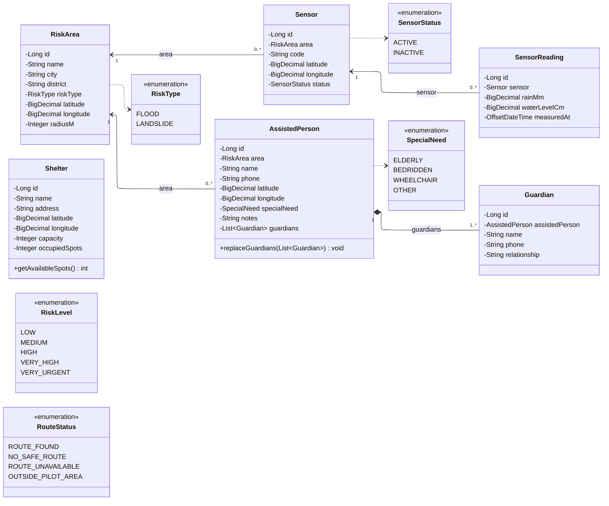
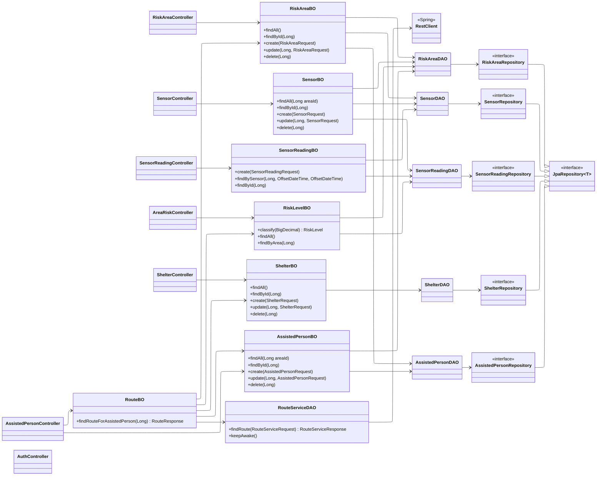
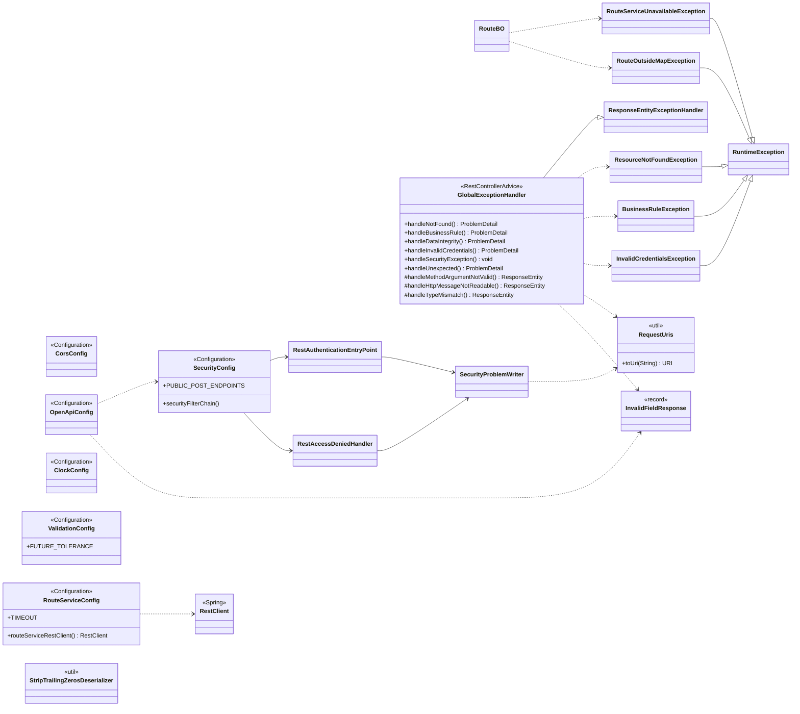

# Rota Segura API — diagrama de classes

Gerado a partir do código em `domain-driven-design-java/backend/src/main/java/br/com/rotasegura/`. Pacote base: `br.com.rotasegura`.
Para caber numa página do PDF, o diagrama está dividido em quatro partes: modelo, camadas, DTOs e exceções/segurança.
A classe `RotaSeguraApplication` (o `main` do Spring Boot) fica de fora de propósito: ela só sobe a aplicação.

## 1. Modelo (pacote `model`)

Entidades JPA (tabelas `T_RS_*`) e enums. `RiskLevel` e `RouteStatus` não são gravados: o nível de risco é calculado na hora pelo `RiskLevelBO`, e o resultado da rota vem do `RouteBO` (RF07).

- `Sensor`, `SensorReading`, `AssistedPerson` e `Guardian` apontam para o "pai" com `@ManyToOne(fetch = LAZY)`.
- `AssistedPerson` → `Guardian` é composição: `@OneToMany(cascade = ALL, orphanRemoval = true)`; o responsável só existe junto da pessoa (e a RN03 exige ao menos um).
- `Shelter` não tem relacionamento: a rota (RN06) escolhe o abrigo mais próximo com vaga.

## 2. Camadas (`controller` → `bo` → `dao` → `repository`)

Nenhuma camada pula a seguinte. Um BO pode usar mais de um DAO (ex.: `SensorBO` confere a área pelo `RiskAreaDAO`).

- `AuthController` não tem BO (decidido em 10/11: autenticação não é regra de negócio); ele usa o Spring Security direto (`AuthenticationManager`, `SecurityContextRepository`, `CsrfTokenRepository`).
- `SensorReadingBO` e `RiskLevelBO` recebem também o `Clock` da aplicação (`config/ClockConfig`).
- `RouteBO` (RF07) usa os outros BOs para ler pessoa, áreas, níveis de risco e abrigos, cada um na sua própria transação curta, e só depois chama o serviço Python pelo `RouteServiceDAO`. Ele **não** é `@Transactional`, para a única conexão do Oracle não ficar presa durante a chamada HTTP (decidido em 16/11).
- `RouteServiceDAO` é o acesso a uma fonte de dados externa (o serviço Python, contrato v2), pelo `RestClient` do Spring configurado em `config/RouteServiceConfig` (URL em `ROUTE_SERVICE_URL`, timeout de 10 s). Não fala com o banco.

## 3. DTOs (pacote `dto`)

Os controllers recebem e devolvem só DTOs (records); as entidades nunca saem da API. Os `Response` das entidades (área, sensor, leitura, abrigo, pessoa assistida e responsável) têm um `from(entidade)`, chamado dentro do BO. Exceções: `AreaRiskResponse` é montado no `RiskLevelBO` (o nível é calculado, não vem de uma entidade), e `CurrentUserResponse` e `CsrfTokenResponse` são montados no `AuthController`.

```mermaid
classDiagram
    direction LR

    class RiskAreaController
    class SensorController
    class SensorReadingController
    class AreaRiskController
    class ShelterController
    class AssistedPersonController
    class AuthController

    class RiskAreaRequest {
        <<record>>
    }
    class RiskAreaResponse {
        <<record>>
    }
    class SensorRequest {
        <<record>>
    }
    class SensorResponse {
        <<record>>
    }
    class SensorReadingRequest {
        <<record>>
    }
    class SensorReadingResponse {
        <<record>>
    }
    class AreaRiskResponse {
        <<record>>
    }
    class ShelterRequest {
        <<record>>
    }
    class ShelterResponse {
        <<record>>
        +Integer availableSpots
    }
    class AssistedPersonRequest {
        <<record>>
        +List~GuardianRequest~ guardians
    }
    class AssistedPersonResponse {
        <<record>>
        +List~GuardianResponse~ guardians
    }
    class GuardianRequest {
        <<record>>
    }
    class GuardianResponse {
        <<record>>
    }
    class LoginRequest {
        <<record>>
    }
    class CurrentUserResponse {
        <<record>>
    }
    class CsrfTokenResponse {
        <<record>>
    }
    class InvalidFieldResponse {
        <<record>>
    }
    class RouteResponse {
        <<record>>
        +Long assistedPersonId
        +RouteStatus status
        +ShelterInfo shelter
        +Integer distanceMeters
        +Integer durationMin
        +List~RoutePoint~ path
        +String message
    }
    class RouteServiceRequest {
        <<record>>
        +Point origin
        +List~ShelterInput~ shelters
        +List~FloodedArea~ floodedAreas
    }
    class RouteServiceResponse {
        <<record>>
        +String status
        +ShelterOutput shelter
        +Integer distanceMeters
        +Integer durationMin
        +List~Point~ path
        +String message
    }
    class RouteServiceDAO

    RiskAreaController ..> RiskAreaRequest
    RiskAreaController ..> RiskAreaResponse
    SensorController ..> SensorRequest
    SensorController ..> SensorResponse
    SensorReadingController ..> SensorReadingRequest
    SensorReadingController ..> SensorReadingResponse
    AreaRiskController ..> AreaRiskResponse
    ShelterController ..> ShelterRequest
    ShelterController ..> ShelterResponse
    AssistedPersonController ..> AssistedPersonRequest
    AssistedPersonController ..> AssistedPersonResponse
    AssistedPersonController ..> RouteResponse
    RouteServiceDAO ..> RouteServiceRequest
    RouteServiceDAO ..> RouteServiceResponse
    AssistedPersonRequest *-- GuardianRequest
    AssistedPersonResponse *-- GuardianResponse
    AuthController ..> LoginRequest
    AuthController ..> CurrentUserResponse
    AuthController ..> CsrfTokenResponse
```

- `InvalidFieldResponse` é usado pelo `GlobalExceptionHandler`: cada item da lista `errors` de um erro de validação (400).
- `RouteServiceRequest` e `RouteServiceResponse` seguem o formato do contrato v2 do Python (`lat`, `lng`, `availableSpots`, `radiusM`) e só circulam entre o `RouteBO` e o `RouteServiceDAO`; os tipos internos (`Point`, `ShelterInput`, `FloodedArea`, `ShelterOutput`) são records aninhados. `RouteResponse` é o que a API devolve, com `ShelterInfo` (inclui o endereço do nosso cadastro) e `RoutePoint` aninhados; é montado no `RouteBO`.

## 4. Exceções, segurança e configuração

- Todos os erros saem em `ProblemDetail` (RFC 7807), com textos em português: os do `GlobalExceptionHandler` e os 401/403 dos filtros de segurança (`SecurityProblemWriter`).
- Status de cada handler: `handleNotFound` 404; `handleBusinessRule` e `handleDataIntegrity` 409; `handleInvalidCredentials` 401; `handleUnexpected` 500; os três `#handle...` (sobrescritos de `ResponseEntityExceptionHandler`) 400 para dados, JSON e parâmetros inválidos. `handleSecurityException` devolve o erro ao Spring Security, que responde 401 ou 403.
- `RouteServiceUnavailableException` e `RouteOutsideMapException` são internas: o `RouteBO` as captura e devolve a rota com status `ROUTE_UNAVAILABLE` ou `OUTSIDE_PILOT_AREA` (sempre 200), então elas nunca chegam ao `GlobalExceptionHandler`.
- `RouteServiceConfig` cria o `RestClient` do serviço Python e liga o `@EnableScheduling` do ping periódico no `/health` (`RouteServiceDAO.keepAwake`).
- `OpenApiConfig` usa `SecurityConfig.PUBLIC_POST_ENDPOINTS` para saber quais operações levam o cadeado do CSRF, e `InvalidFieldResponse` para descrever a lista `errors` no Swagger.
